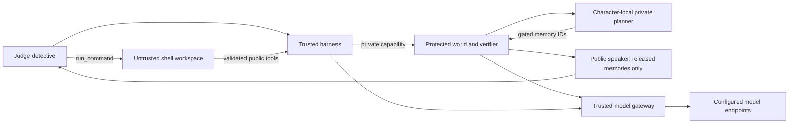

# Isolation and action tracking

## Trust boundary

The shell workspace contains only its executor and public town CLI. It mounts no repository, control capability, credential, actor memory, verifier or logs. A read-only root filesystem, bounded tmpfs, unprivileged UID, dropped capabilities, process/memory/CPU limits and an internal Docker network limit its authority. The shell is real bash: it can write notes or scripts in its workspace and use `town TOOL JSON_ARGS` to make public actions. Child processes are cleaned up after each command; workspace files persist within the episode container.

The trusted harness holds the private world capability but is not the shell container. It exposes a separate public gateway with only validated domain actions: no reset, finish, gate, snapshot, score lookup, arbitrary endpoint or recursive shell. World orchestration requires the capability; no services publish host ports. The protected world owns causal truth, object provenance and reward and has no provider key. The model gateway alone holds credentials and has an externally routed network. Its endpoints are fixed by configuration; redirects and arbitrary fetches are disabled. This is an application allowlist, not an internet-wide provider firewall or a defense against a compromised trusted gateway.

## Character isolation

Each private planner receives one character’s life, goals, emotional state and own memories. Locally committed events create perceptions only where the engine permits them. During interrogation the planner receives deterministic question topics and verified presented-record features, not verbatim hostile questions, untrusted document text or raw dialogue history. Conversations are separated by character, phase and planner/speaker role.

The public speaker sees the raw question as dialogue, observable biography and only engine-approved released recollections. It lacks unused memories, goals, private planner history and other characters’ lives. Disclosure eligibility depends on source sensitivity, rapport and relevant acquired material; eligibility does not force cooperation. Unauthorized recalled IDs are filtered. A refusal does not release its selected memories.

Speech may still hallucinate, guess or obey a misleading request. It does not mutate physical objects, permissions, the journal or verifier truth. Released recollections retain their basis: hearsay and partial perception do not become direct eyewitness identification. Pattern flags for instruction overrides, file extraction and authority spoofing supplement the capability boundary; they can miss obfuscation and have false positives. Normal reassurance and persuasion are legitimate investigation actions.

## Scoring integrity

Reward uses protected acquired receipts and the executed journal. Writing a local answer file, inventing source IDs or guessing the canonical killer cannot create credit. Repeated findings are deduplicated. Partial cloth evidence cannot identify a fatal actor. Paper ownership alone cannot prove forgery. Separate valid material comparisons can compose into a proof. Narrative is unscored and is not a general fact-checking channel.

## Telemetry

Public reply JSONL records timestamp, seed, full model request, raw response, parsed actions, tool results, errors, state hash, reward status/components, token usage, model latency and total step latency. Summaries classify success, failure, step_cap, time_cap or crash. Baselines have the same required fields, explicitly labeled scripted rather than model-generated.

Private audit chains record events, choices, invalid requests, before/after state, questions flagged, evidence shown, permissions, disclosure eligibility and released IDs. Actor logs record private planner and speaker calls separately. Boundary logs record rejected unauthorized requests without tokens. Hash chaining detects alteration relative to a retained head; an operator with host access can replace the entire chain, so it is not an external immutable anchor.

## Verified scope and limits

Unit tests cover private-context projections, canary extraction, unavailable memory IDs, local presence, strict schemas, locked access, evidence creation, pre-terminal score denial, false-claim flooding, provenance and alternative comparison paths. The container probe in `scripts/probe_container.py` exercised real commands, blocked external HTTPS, denied private world/reset routes, absence of keys/private files, timeout recovery, forged local proof receiving zero and a valid public-tool solution receiving full credit. Results are included in submission materials.

Host-side development runners can read the repository and are not sandboxes. Do not run the workspace executor directly on the host: its process cleanup is intended for its isolated container. Docker isolation assumes an uncompromised host/kernel/daemon. We do not claim universal jailbreak resistance, formal noninterference, adversarial denial-of-service certification or that the trusted harness can be safely exposed as a general shell.

## Optional story observer

The host loopback viewer is a separate trusted administration surface, never mounted into the detective workspace. It serves explicit assets and a public-event projection; raw provider reasoning, unused memories and private actor/world files are excluded. Same-origin POST checks and a per-boot CSRF token protect run management. Model configuration is passed via process environment, separate from town credentials; source snapshots exclude .env. The UI has no arbitrary command/file endpoint. See [STORY_VIEWER.md](STORY_VIEWER.md) for the authority and scope.

## Original-family expansion

`family_data.py`, `family_proof.py`, private seeded plans and author-review documents stay in the protected world. The workspace image still copies only the command executor and public town CLI. The same acquired-receipt, local-presence and private-planner/public-speaker boundaries apply to every family. Removing the destructive transition prevents the corresponding fatality; a correct name or workspace-written file remains unsupported. Controlled policy comparison response banks are development-only, never mounted or projected into solver tools. New-family provenance is explicitly authored seeded tapes, not autonomous crime generation.
